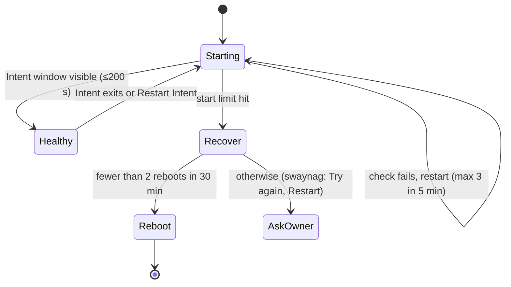

# Intent OS design

## 1. Goal

Boot a computer straight into the Intent desktop app. Keep a full Linux system under it.
Show no other apps. Keep the device updated and recover from failure without the owner.

## 2. Packaging model

Follow the Omarchy pattern (Arch, btrfs + snapper, ISO installer), but ship only the
base layer.

1. **pacman packages are the product.** Everything is in five packages (see README).
2. **The ISO is a small netinstall image.** It carries only a minimal live system built
   from archiso's `baseline` profile: kernel, disk tools, NetworkManager, the installer,
   Wi-Fi firmware, and the MacBook Air `wl` driver prebuilt for the live kernel (no
   compiler on the stick). The build fails if the ISO passes 560 MiB (520 MiB today). The installer downloads
   packages from the Arch snapshot the image was tested with and the signed `intent-os`
   repo, so it installs the set that passed the boot test. It needs a network.
   Installed systems get laptop and desktop firmware, including Intel SOF audio (no Qualcomm, Mellanox, NVIDIA,
   Marvell).
3. **OS updates are `pacman -Syu`** against the pinned snapshot, plus the signed
   `intent-os` repo for Intent OS packages. **Intent updates itself** in the app.

## 3. Use Intent as written

Few changes to `cloudlands-fe` or `intentd`: a hidden-menu-bar option and the sign-in window (§4.7).

| Need | How |
|---|---|
| Intent build | The released AppImage. `intent-appimage` ships it in `/usr/share/intent-os/`; `prepare-intent` copies it to `~/.local/lib/intent-os/Intent.AppImage` on first start. `bump-intent.yml` keeps the seed on the newest alpha. |
| Intent updates | Intent's own updater (electron-updater, AppImage path) replaces the owner's copy and relaunches. The owner sees Intent's normal update prompt. The `.deb` path cannot work here: it needs `dpkg`. |
| `intentd` | Electron starts its bundled sidecar as usual. |
| Channel | First start writes `updateChannel: "alpha"` (newest Intent) and `menuBarAutoHide: true` to `~/.config/Intent/local-prefs.json`. The owner can change the channel in settings. |
| Secrets | No keyring daemon. Electron falls back to its basic store; `intentd` uses none. |

## 4. Session

```text
greetd (autologin "intent") -> intent-os-session -> sway (kiosk config)
   session-start: swaylock first, then intent-os-session.target
       intent.service      Intent, supervised
       intent-os-idle      lock after 5 min idle and before sleep
       intent-os-top-bar   hover the top edge: network, battery, clock, restart Intent, restart, power
       intent-os-windows   each new Intent window gets its own workspace
```

1. **sway, not cage.** The PIN lock needs `ext-session-lock`, which cage lacks.
2. **Lock first.** `swaylock -f` returns only once the screen is locked, then Intent
   starts behind the lock. It is never visible before the PIN.
3. **PIN = the owner's Linux password.** The lock screen is hyprlock (clock and an "Enter PIN" field; swaylock is the fallback). After 10 wrong PINs it waits a minute (faillock). Both check it through PAM. Root is locked.
   **Full admin without prompts:** Intent is the whole computer, so the owner runs
   `sudo` without a password and polkit allows `wheel` every action (there is no
   password dialog to answer). The PIN guards the screen, not admin rights.
4. **Controls** take no space: move the pointer to the top edge and a bar opens over
   Intent (GTK layer-shell); it closes when the pointer leaves. Controls are on its right. Restart and Shut down ask once in a
   swaynag bar (no password). The polkit rule also covers user services.
5. **No terminal app.** Intent is the only way to install and sign in to coding agents,
   using its own terminals. This is a deliberate test of Intent as the whole computer;
   gaps found here become small Intent changes, not more OS apps. Emergency access only:
   Ctrl+Alt+F2 opens a text console (user `intent`, the PIN).
6. **Wi-Fi.** Clicking the network name opens a dropdown (`fuzzel`) under it: nearby
   networks with signal, a password prompt only for new secured networks, and Turn
   Wi-Fi off/on. Failures show in a swaynag bar.
7. **Web pages.** There is no browser. `intent-os-open` is the default browser
   (`BROWSER`, `xdg-open`): it passes `http(s)` links to the running Intent
   (`--open-url=`), which shows them in a small sign-in window. A CLI sign-in
   (`claude auth login`) finishes there, and the window closes when the page returns
   to the CLI. Escape closes it.
8. **Keys:** brightness, keyboard backlight, volume and play/pause/next/previous keys work,
   also when locked; volume and brightness briefly show the top bar, and F3 shows it. The
   bar has a volume item: click mutes, scrolling changes the volume.
   Ctrl+Cmd+Q locks. Cmd+C/X/V copy, cut and paste in Intent, terminal included, and
   Ctrl keeps its usual meaning (Intent handles Super+C/X/V on Linux). The power key suspends (it sits next to Delete on the Air).
   Cmd+Left/Right (keyd sends Super+Left/Right) go to the previous/next Intent window.
10. **One workspace per window.** `intent-os-windows` follows sway window events. The
   first Intent window stays on workspace 1; each new tiled Intent window (for example a
   tab opened in its own window) moves to the workspace after the highest one in use, and
   gets focus. So Super+Left/Right (`workspace prev/next_on_output`) step through the
   windows in creation order. Floating dialogs stay where they open. sway removes
   empty workspaces. The QEMU boot test opens a second window with Ctrl+Shift+N and
   checks the placement and both keys; `intent-os-test-report` prints the sway state
   to the serial console, only when QEMU passes `opt/intent-os/test`.

9. **Stay awake while agents work.** `intent-os-keep-awake` asks the local intentd for
   mid-turn agents (`agent.listActive` on its Unix socket) every 20 s. While one is
   working and the device is on power, a logind inhibitor blocks sleep, the lid and the
   suspend key; it is released when every agent is idle or the power is unplugged.
   Agents on remote machines do not count. The top bar shows a coffee icon meanwhile.
10. **Passkeys.** Intent's browser panel signs in with passkeys on its own (Intent's
   `intent-passkey` helper; this repo adds only OS parts). A phone signs in over a QR
   code and Bluetooth LE, so `bluez` runs (`bluetooth.service`; skipped when there is no
   adapter). Device passkeys are confirmed with the PIN through PAM service
   `intent-passkey` (same stack as the lock screen); Intent offers them only when
   `/etc/pam.d/intent-passkey` exists. `run-intent` sets `INTENT_BROWSER_PASSKEYS=1`, which
   turns passkeys on in Intent (off by default elsewhere). With no TPM, those keys are on disk, encrypted
   with a key made from the PIN: a stolen disk allows offline PIN guessing, so a long
   PIN is safer.
11. **File choosers.** The session has no desktop portal, so native file dialogs open
   nothing. `run-intent` sets `INTENT_IN_APP_PICKER=1`, and Intent uses its own picker for
   open, save, import, export and attachment choosers, website uploads and downloads in
   its browser panel (needs a cloudlands-fe build with intent-hq/cloudlands-fe#4830).
   Not covered: a site's File System Access picker (`showOpenFilePicker`) and uploads
   inside cross-origin iframes.

## 5. Supervision



1. `intent.service` runs `run-intent`. It forwards SIGTERM to Intent, and after an
   in-app update it follows the relaunched Intent, so systemd keeps one supervised
   instance. `ExecStartPost=intent-health`, which waits for a visible sway
   window with app id or class `intent`. A failed check fails the start.
2. On success it starts `intent-os-boot-ok.service`, which sets `boot_success=1` in
   `/efi/intent-os/grubenv`.
3. GRUB resets the flag on every boot. If a boot never reached a healthy Intent, the next
   boot shows the menu for 10 s, including **Intent OS snapshots** (grub-btrfs). Snapshots
   boot read-only through an overlay.

## 6. Updates

1. **Staged snapshot.** Devices use `archive.archlinux.org/repos/<date>`. CI builds a
   nightly image on yesterday's snapshot, installs and boots it in QEMU, and only then
   publishes `channel.env` (date + build id). Devices never move to a date that has not
   passed the test, and never move backwards.
2. **When.** `intent-os-update.timer` checks hourly. It runs only when the session's
   logind IdleHint is set (5 min idle) and the device is on AC power.
3. **Incremental.** An update is `pacman -Su`: it downloads only packages that changed.
   Each CI build stamps the Intent OS packages `0.1.0.<build time>`, so a changed
   package is always newer. `sudo /usr/lib/intent-os/update --now` updates at once.
4. **Snapshots.** snap-pac takes btrfs pre/post snapshots around every pacman run.
5. **Intent** is not part of the OS update. It updates its own AppImage, which the
   owner's account owns, and asks before it restarts. Running agents are never stopped
   by an OS update.
6. **Undo.** The update wraps itself in a snapper pre/post pair and records it in
   `/var/lib/intent-os/last-update`. The top bar then shows an undo icon; after a
   confirmation, `undo-update` runs `snapper undochange pre..post`, skips that build until
   a newer one is published, and restarts.
7. **Reboot hint.** A pacman hook marks `/run/intent-os/reboot-required` after kernel,
   firmware, systemd, glibc, Mesa, sway, or Wi-Fi driver updates. A dot on **Restart**
   shows it. The device never reboots by itself for an update.

## 7. MacBook Air, Early 2014 (MacBookAir6,1 / 6,2)

| Part | Support |
|---|---|
| Boot | UEFI. GRUB installs to the fallback path (`--removable`), so no NVRAM writes. |
| Graphics | Intel HD 5000 (Haswell), Mesa `crocus`. VA-API through `libva-intel-driver`. |
| Wi-Fi | Broadcom BCM4360. `broadcom-wl-dkms` (Arch no longer ships a prebuilt `wl`); it rebuilds on each kernel update. Also on the ISO. The CI boot test installs it. |
| Suspend | Works. XHC1 and ARPT wake sources are off to stop instant wake-up. |
| Keyboard, trackpad | `hid_apple` (media keys first), `bcm5974`; tap, natural scroll, click-finger. |
| Audio | Cirrus CS4208 through PipeWire. |
| Brightness | `intel_backlight` and `smc::kbd_backlight` through brightnessctl. |
| Fan | SMC firmware control. `mbpfan` not included (AUR only). |
| Camera | FaceTime HD through `facetimehd` (DKMS, built in CI). Its firmware is Apple's: on first boot with a network, `intent-os-facetimehd-firmware` downloads 2.7 MB of Apple's OS X 10.11.5 update, extracts and checks it. |
| Bluetooth | Broadcom BCM20702 (USB, `btusb`), Bluetooth 4.0 LE, through BlueZ. Used for phone passkeys (FIDO hybrid). |
| Memory | 4 GB or 8 GB. zram swap at half of RAM. Run agents remotely on 4 GB models. |

## 7a. Intel Macs with the T2 chip (2018–2020)

1. **Kernel.** The keyboard, trackpad, audio and Touch Bar sit behind the T2 and need the
   t2linux kernel (`linux-t2`, driver `t2bce`). CI copies `linux-t2` and the T2 helper
   packages from the unsigned `arch-mact2` repo into the signed `intent-os` repo, after
   checking each file against the sha256 in that repo's database.
2. **Installer.** The live ISO boots `linux-t2` on every machine (it is Arch's kernel plus
   T2 drivers). A second menu entry, **Mac with T2 chip**, adds `intel_iommu=on iommu=pt
   pm_async=off`; the default entry leaves them off (they broke the BCM43602 Wi-Fi of a
   2016 MacBook Pro).
3. **Wi-Fi firmware** is Apple's and only ships with macOS. On a T2 Mac the installer runs
   `apple-bcm-firmware-fetcher` before it erases the disk, then copies the files to the
   installed system.
4. **Installed system.** `intent-os-hw-t2` (selected by the T2 PCI ID `106b:1801`) adds
   `linux-t2` as the default GRUB entry (Arch's kernel stays as a fallback), fan control
   (`t2fanrd`) and the Touch Bar (`tiny-dfr`).
5. **Tests:** by hand on a T2 Mac. The QEMU boot test covers the T2 kernel on generic
   hardware through the live ISO.

## 8. aarch64 (UTM on Apple silicon, UEFI ARM machines)

1. **Same shape as x86_64:** a netinstall ISO with the same installer. One ISO per
   architecture covers real hardware and VMs (UTM boots ISOs).
2. **Base:** Arch Linux ARM (`linux-aarch64`). archiso is not packaged there, so the build
   runs `mkarchiso` from the archiso Git tag in `build/in-container.sh` (`ARCHISO_REF`),
   with the `uefi.grub` boot mode only. Live packages: `iso/packages.aarch64`.
3. **Kernel name:** `intent-os-bootstrap` ships a pacman hook that hard-links
   `/boot/Image` to `/boot/vmlinuz-linux`, the name mkarchiso, GRUB and grub-btrfs expect.
4. **Updates:** Arch Linux ARM has no archive, so aarch64 devices follow normal mirrors.
   Intent OS packages come from the signed `repo-aarch64` release.
5. **Tests:** the aarch64 ISO is tested by hand in UTM before release. `tests/smoke.sh`
   can run the same install-and-boot test on it, but GitHub's arm64 runners have no KVM,
   so CI runs it only on demand (`arm64_smoke` workflow input).
6. **Bare-metal Apple silicon** uses the Asahi image instead (§8b).

## 8b. Apple silicon (M1, M2) on Asahi Linux

1. **No USB boot.** Apple silicon boots only through Apple's boot policy, so Linux goes
   next to macOS through the Asahi installer, run from macOS (`asahi/install.sh`). It
   uses the Asahi ALARM installer build with our `installer_data.json`.
2. **Image.** `make image-asahi` (aarch64) runs `intent-os-install` in image mode on a
   loop ESP (fixed volume ID) and a 6 GiB btrfs root, then zips `esp/` and `root.img`.
   The Asahi installer copies them, adds Apple's firmware to the ESP, and grows the root
   partition; `x-systemd.growfs` grows btrfs on first boot.
3. **Packages.** `intent-os-hw-apple-silicon` pulls `asahi-meta` (linux-asahi, m1n1,
   U-Boot, firmware tools), Asahi Mesa and speaker safety from the `asahi-alarm` repo,
   which devices keep before Arch Linux ARM's repos. The `asahi` initramfs hook loads
   the firmware. The boot chain is m1n1 → U-Boot → GRUB (`BOOTAA64.EFI`), so snapshots
   and the boot-ok flag work as on PCs.
4. **First boot:** PIN and time zone only (the system is installed); Wi-Fi from the top
   bar.
5. **Not covered:** M3 and newer (Asahi does not support them yet). **Untested:** no VM
   runs this boot chain; test by hand on an M1 or M2 Mac.

## 9. Later

1. Permanent rollback command (today: boot a snapshot from the GRUB menu).
2. Disk encryption. The Air has no TPM, so LUKS would need a boot passphrase.
3. Other hardware packages. Apple Silicon on an Asahi base, reusing the session and
   update packages.
4. Crash-recovery case in the QEMU test (needs a guest agent).
