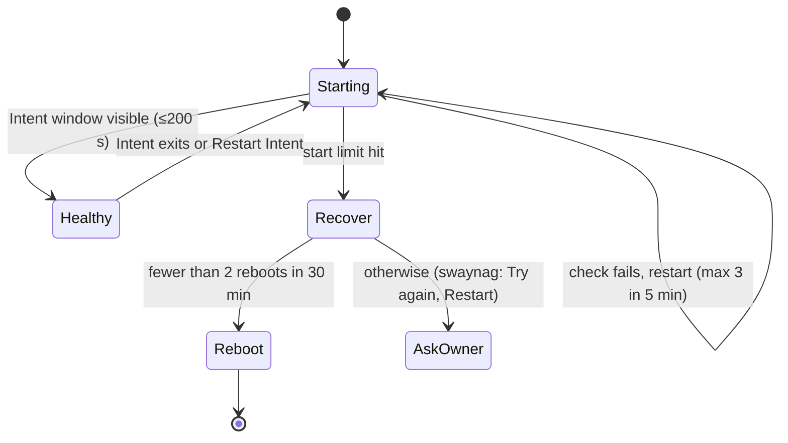

# Intent OS design

## 1. Goal

Boot a computer straight into the Intent desktop app. Keep a full Linux system under it.
Show no other apps. Keep the device updated and recover from failure without the owner.

## 2. Packaging model

Follow the Omarchy pattern (Arch, btrfs + snapper, ISO installer), but ship only the
base layer.

1. **pacman packages are the product.** Everything is in five packages (see README).
2. **The ISO is a small netinstall image.** It carries only a minimal live system built
   from archiso's `baseline` profile: kernel, disk tools, NetworkManager, the installer,
   Wi-Fi firmware, and the MacBook Air `wl` driver prebuilt for the live kernel (no
   compiler on the stick). The build fails if the ISO passes 560 MiB (520 MiB today). The installer downloads
   packages from the Arch snapshot the image was tested with and the signed `intent-os`
   repo, so it installs the set that passed the boot test. It needs a network.
   Installed systems get laptop and desktop firmware (no Qualcomm, Mellanox, NVIDIA,
   Marvell).
3. **OS updates are `pacman -Syu`** against the pinned snapshot, plus the signed
   `intent-os` repo for Intent OS packages. **Intent updates itself** in the app.

## 3. Use Intent as written

No changes to `cloudlands-fe` or `intentd`.

| Need | How |
|---|---|
| Intent build | The released AppImage. `intent-appimage` ships it in `/usr/share/intent-os/`; `prepare-intent` copies it to `~/.local/lib/intent-os/Intent.AppImage` on first start. `bump-intent.yml` keeps the seed on the newest alpha. |
| Intent updates | Intent's own updater (electron-updater, AppImage path) replaces the owner's copy and relaunches. The owner sees Intent's normal update prompt. The `.deb` path cannot work here: it needs `dpkg`. |
| `intentd` | Electron starts its bundled sidecar as usual. |
| Channel | First start writes `updateChannel: "alpha"` (newest Intent) and `menuBarAutoHide: true` to `~/.config/Intent/local-prefs.json`. The owner can change the channel in settings. |
| Secrets | No keyring daemon. Electron falls back to its basic store; `intentd` uses none. |

## 4. Session

```text
greetd (autologin "intent") -> intent-os-session -> sway (kiosk config)
   session-start: swaylock first, then intent-os-session.target
       intent.service      Intent, supervised
       intent-os-idle      lock after 5 min idle and before sleep
   swaybar (top, 24 px)    network, battery, clock, then icons: restart Intent, restart, power
```

1. **sway, not cage.** The PIN lock needs `ext-session-lock`, which cage lacks. sway also
   gives a built-in bar, so device controls need no extra process.
2. **Lock first.** `swaylock -f` returns only once the screen is locked, then Intent
   starts behind the lock. It is never visible before the PIN.
3. **PIN = the owner's Linux password.** swaylock checks it through PAM. It is also the
   `sudo` password. Root is locked.
4. **Controls** are in the top-right of the bar. Restart and Shut down ask once in a
   swaynag bar (no password). A polkit rule lets `wheel` reboot and power off from user
   services.
5. **No terminal app.** Intent is the only way to install and sign in to coding agents,
   using its own terminals. This is a deliberate test of Intent as the whole computer;
   gaps found here become small Intent changes, not more OS apps. Emergency access only:
   Ctrl+Alt+F2 opens a text console (user `intent`, the PIN).
6. **Wi-Fi.** Clicking the network name opens a dropdown (`fuzzel`) under it: nearby
   networks with signal, a password prompt only for new secured networks, and Turn
   Wi-Fi off/on. Failures show in a swaynag bar.
7. **Keys:** brightness, keyboard backlight, and volume keys work, also when locked.
   Ctrl+Cmd+Q locks. The power key suspends (it sits next to Delete on the Air).

## 5. Supervision



1. `intent.service` runs `run-intent`. It forwards SIGTERM to Intent, and after an
   in-app update it follows the relaunched Intent, so systemd keeps one supervised
   instance. `ExecStartPost=intent-health`, which waits for a visible sway
   window with app id or class `intent`. A failed check fails the start.
2. On success it starts `intent-os-boot-ok.service`, which sets `boot_success=1` in
   `/efi/intent-os/grubenv`.
3. GRUB resets the flag on every boot. If a boot never reached a healthy Intent, the next
   boot shows the menu for 10 s, including **Intent OS snapshots** (grub-btrfs). Snapshots
   boot read-only through an overlay.

## 6. Updates

1. **Staged snapshot.** Devices use `archive.archlinux.org/repos/<date>`. CI builds a
   nightly image on yesterday's snapshot, installs and boots it in QEMU, and only then
   publishes `channel.env` (date + build id). Devices never move to a date that has not
   passed the test, and never move backwards.
2. **When.** `intent-os-update.timer` checks hourly. It runs only when the session's
   logind IdleHint is set (5 min idle) and the device is on AC power.
3. **Snapshots.** snap-pac takes btrfs pre/post snapshots around every pacman run.
4. **Intent** is not part of the OS update. It updates its own AppImage, which the
   owner's account owns, and asks before it restarts. Running agents are never stopped
   by an OS update.
5. **Reboot hint.** A pacman hook marks `/run/intent-os/reboot-required` after kernel,
   firmware, systemd, glibc, Mesa, sway, or Wi-Fi driver updates. A dot on **Restart**
   shows it. The device never reboots by itself for an update.

## 7. MacBook Air, Early 2014 (MacBookAir6,1 / 6,2)

| Part | Support |
|---|---|
| Boot | UEFI. GRUB installs to the fallback path (`--removable`), so no NVRAM writes. |
| Graphics | Intel HD 5000 (Haswell), Mesa `crocus`. VA-API through `libva-intel-driver`. |
| Wi-Fi | Broadcom BCM4360. `broadcom-wl-dkms` (Arch no longer ships a prebuilt `wl`); it rebuilds on each kernel update. Also on the ISO. The CI boot test installs it. |
| Suspend | Works. XHC1 and ARPT wake sources are off to stop instant wake-up. |
| Keyboard, trackpad | `hid_apple` (media keys first), `bcm5974`; tap, natural scroll, click-finger. |
| Audio | Cirrus CS4208 through PipeWire. |
| Brightness | `intel_backlight` and `smc::kbd_backlight` through brightnessctl. |
| Fan | SMC firmware control. `mbpfan` not included (AUR only). |
| Camera | Not supported (needs out-of-tree `facetimehd`). |
| Memory | 4 GB or 8 GB. zram swap at half of RAM. Run agents remotely on 4 GB models. |

## 8. arm64 VM image (Apple silicon Macs)

1. **Base:** Arch Linux ARM (`linux-aarch64`). Same packages and session as x86_64,
   except the MacBook Air package and firmware.
2. **Shape:** a small ready-to-boot qcow2 disk, the VM counterpart of the netinstall
   ISO. CI runs the installer in image and bootstrap mode onto loop devices inside an
   Arch Linux ARM container: kernel, network, GRUB and `intent-os-bootstrap` only, with
   a generic initramfs. The build fails above 700 MiB (about 640 MiB today, close to the x86_64 netinstall).
3. **First boot:** `intent-os-firstboot.service` (from `intent-os-bootstrap`) asks for
   the PIN and time zone on the console, downloads Intent OS, sets up snapshots, GRUB
   and services, and restarts into Intent.
4. **Kernel name:** a pacman hook copies `/boot/Image` to `/boot/vmlinuz-linux` so
   `grub-mkconfig` (and grub-btrfs snapshots) find it.
5. **Updates:** Arch Linux ARM has no archive, so arm64 devices follow normal mirrors.
   Intent OS packages come from the signed `repo-aarch64` release.
6. **Tests:** `tests/smoke-arm64.sh` boots the image, answers the first-boot prompts,
   waits for Intent, and unlocks. It uses KVM when the runner has it, else TCG.

## 9. Later

1. Permanent rollback command (today: boot a snapshot from the GRUB menu).
2. Disk encryption. The Air has no TPM, so LUKS would need a boot passphrase.
3. Other hardware packages. Apple Silicon on an Asahi base, reusing the session and
   update packages.
4. Crash-recovery case in the QEMU test (needs a guest agent).
